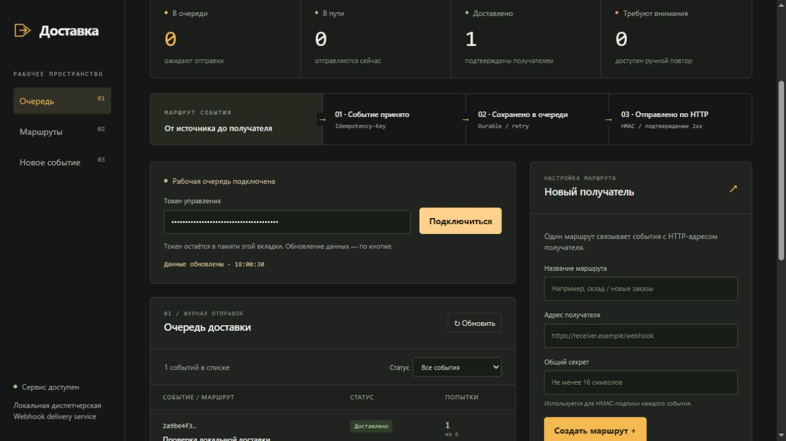

# Доставка


Локальный сервис отправки HTTP-вебхуков с очередью на диске и русской диспетчерской. Помогает отделить приём события от доступности получателя: событие сохраняется, сервис отправляет его и фиксирует результат каждой попытки.

Версия **0.1.0-rc.1**. Сервис рассчитан на одну инстанцию и доверенного оператора.

<details>
<summary>Рабочая диспетчерская</summary>



</details>

## Что происходит с событием

```text
HTTP API → сохранение на диске → очередь → подписанный POST → результат
                                      ↳ повтор → dead letter → ручной повтор
```

- Подписка задаёт адрес получателя и общий секрет. Адрес и секрет сохраняются в доставке на момент приёма события.
- `Idempotency-Key` защищает от повторного добавления: тот же ключ с прежним содержимым возвращает существующую доставку, с другим — HTTP 409.
- Число одновременных отправок ограничивается `--workers`. Запрос получателю имеет timeout 10 секунд; HTTP 2xx подтверждает доставку, редиректы не следуются.
- При ошибке предусмотрено шесть попыток с задержками 1, 2, 4, 8 и 16 секунд. Исчерпанные попытки переводят сообщение в `dead`; оператор может начать новый цикл.
- После перезапуска незавершённые `inflight` возвращаются в очередь. Получатель может увидеть повтор, поэтому должен обрабатывать delivery ID идемпотентно.
- Панель показывает маршруты, JSON события, состояния и ошибки. `/metrics` отдаёт количество доставок по состояниям в формате Prometheus.

Отключение подписки запрещает новый приём в этот маршрут. Уже принятые события продолжают отправляться по сохранённым реквизитам.

## Запуск

Нужен **Go 1.23+**. Проверено на Windows с Go 1.27.2. Сторонних Go-модулей нет; HTML встроен в бинарник через `go:embed`. Отдельные Node.js, база данных или сборка фронтенда для работы сервиса не требуются.

Из каталога репозитория, PowerShell:

```powershell
$env:DOSTAVKA_TOKEN = [guid]::NewGuid().ToString('N')
$env:DOSTAVKA_TOKEN

go run . --listen 127.0.0.1:8787 --data data/state.json --workers 4
```

Откройте [диспетчерскую](http://127.0.0.1:8787) и введите выведенный токен. Токен остаётся в памяти вкладки. Остановка сервиса — `Ctrl+C`; данные сохраняются в `data/state.json`.

| Параметр | Значение по умолчанию | Назначение |
|---|---|---|
| `DOSTAVKA_TOKEN` | Обязателен, минимум 24 символа | Доступ к управлению и метрикам |
| `--listen` | `127.0.0.1:8787` | HTTP-адрес сервиса |
| `--data` | `data/state.json` | Файл состояния |
| `--workers` | `4`, допустимо 1–64 | Максимум параллельных отправок |
| `--allow-remote` | Выключен | Явно разрешить адрес вне loopback |

`/health` и оболочка UI открыты; `/api/*` и `/metrics` требуют `Authorization: Bearer TOKEN`. Для внешнего доступа дополнительно нужны TLS reverse proxy и сетевые ограничения. Регистрация произвольных URL недоверенными пользователями вне выбранной модели: оператор может указывать в том числе локальные адреса.

## Демонстрация: доставка, повторный приём, отказ

1. Запустите сервис по инструкции выше.
2. В другом терминале запустите локального получателя. Для этого демонстрационного примера нужен Node.js; самому Go-сервису он не нужен:

   ```powershell
   node -e "require('node:http').createServer((req,res)=>{let body='';req.on('data',c=>body+=c);req.on('end',()=>{console.log(req.headers['x-dostavka-id'],body);res.writeHead(204);res.end()})}).listen(9797,'127.0.0.1')"
   ```

3. В панели подключитесь с токеном. Создайте маршрут «Локальный склад», адрес `http://127.0.0.1:9797/webhook`, секрет `demo-shared-secret-2026`. Это публичный демонстрационный секрет, для своих интеграций задайте другой.
4. Отправьте `{"type":"order.created","order_id":42}` с ключом `demo-order-42`. Обновите очередь: появится `delivered`, в терминале получателя — ID и тело запроса.
5. Отправьте тот же JSON с тем же ключом. В очереди останется одна доставка. Измените JSON, сохранив ключ: получите конфликт, новая доставка не добавится.
6. Остановите получателя и отправьте событие с новым ключом. Обновляйте очередь: ошибки и число попыток видны в строке. После исчерпания попыток появится ручной повтор.
7. Снова запустите получателя, нажмите «Повторить», обновите очередь. Для проверки сохранения остановите и запустите Go-сервис с тем же `--data`.

## API и подпись

| Метод и путь | Действие |
|---|---|
| `POST /api/subscriptions` | Создать маршрут: `name`, `url`, `secret` |
| `GET /api/subscriptions` | Список маршрутов без секретов |
| `DELETE /api/subscriptions/{id}` | Отключить приём новых событий |
| `POST /api/events` | Принять `subscription` и `event`, требуется `Idempotency-Key` |
| `GET /api/deliveries?status=dead` | Список доставок, необязательный фильтр состояния |
| `POST /api/deliveries/{id}/retry` | Повторить доставку в состоянии `dead` |
| `GET /health`, `GET /metrics` | Состояние сервиса и счётчики очереди |

Вход ограничен 1 MiB. У нового события ответ 202, у повторного — 200. Ключ идемпотентности глобален для сервиса, длиной 1–200; сравниваются ID подписки и точные JSON-байты поля `event`, включая порядок полей и пробелы. Некорректный запрос даёт 400, неверный токен — 401, отсутствующий маршрут — 404, конфликт — 409, ошибка сохранения — 503.

Получатель получает заголовки:

```text
X-Dostavka-ID: стабильный идентификатор доставки
X-Dostavka-Timestamp: Unix time в секундах
X-Dostavka-Signature: sha256=<hex HMAC-SHA256(secret, timestamp + "." + raw_body)>
```

На стороне получателя нужны constant-time проверка подписи, допустимое окно времени и дедупликация по ID. Гарантия сервиса — **at least once**; однократное исполнение действия обеспечивает получатель.

## Устройство и границы

Фактический стек: Go standard library (`net/http`, `crypto/hmac`, `crypto/sha256`, `encoding/json`, `sync`) и встроенный HTML/CSS/JavaScript. Изменения сериализуются mutex; полный JSON-снимок записывается во временный файл, синхронизируется и заменяет прежний до успешного ответа API. При неудачной записи изменения в памяти откатываются.

JSON выбран ради простой локальной установки и понятного восстановления. Цена решения — перезапись всей накопленной истории при изменении. Очередь и ключи не очищаются автоматически, порядок доставки не гарантируется. Это не кластерный брокер и не сервис для неограниченного потока событий.

Один файл данных должен принадлежать одному процессу. Используйте локальный диск; атомарность на сетевых файловых системах не проверялась. Секреты подписок хранятся в файле состояния открыто, каталог нужно защищать правами ОС. Для резервной копии остановите процесс и скопируйте файл; восстанавливайте его также при остановленном процессе.

## Проверки и документы

```powershell
go test -count=1 ./...
go vet ./...
go build -o dostavka.exe .
```

Локально прошли 5 тестов с `httptest`, vet и сборка: подпись, идемпотентность, конфликт, restart/recovery, dead letter, ручной retry, auth, rollback при ошибке диска и ограничение workers. Конфигурация [GitHub Actions](.github/workflows/checks.yml) добавлена; выполнение CI на GitHub пока не подтверждено.

- [Архитектура и компромиссы](ARCHITECTURE.md)
- [Фактически выполненные проверки](VERIFICATION.md)
- [Изменения выпуска](RELEASE_NOTES.md)
- [Источники визуального решения](DESIGN_PROVENANCE.md)
- [HTTP API и worker](main.go), [тесты](main_test.go), [исходник панели](admin.html)

## Лицензия

Отдельный `LICENSE` в репозитории пока отсутствует; лицензия проекта не задана.
